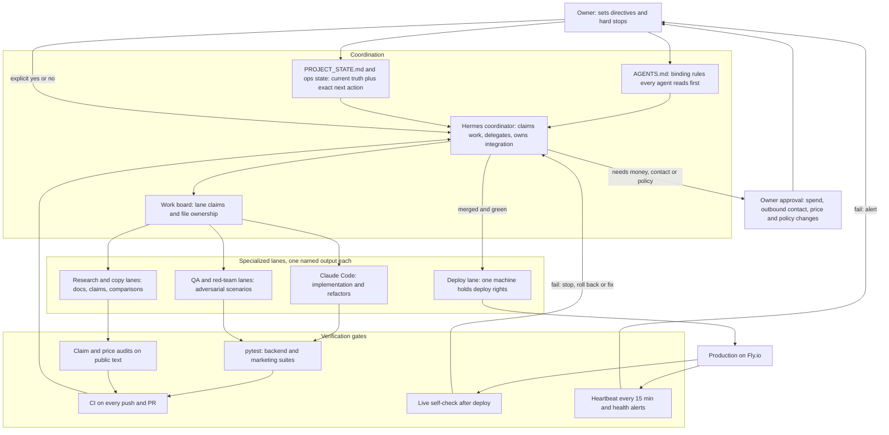

# Agent Engineering Lab

How I run several AI coding agents on one production codebase without losing control of it: who does what, what has to pass before work is accepted, what happens when something fails, and which decisions stay with me.

The code is private. This repo is the write-up, plus sanitized descriptions of the mechanisms in [`docs/`](docs/). The codebase the workflow was built around is Call Kettle, an AI phone receptionist for service businesses that runs on Fly.io. A cleaned-up public snapshot of it is at [samiali38183/call-kettle](https://github.com/samiali38183/call-kettle).

Agents involved: **Hermes Agent** (coordination, QA, repo work, scheduled jobs), **Claude Code** (in-repo implementation and refactors against the test suite) and **Codex** (used on the same machine; I do not describe a dedicated role for it because I have no written lane for it). The product's own runtime agent is **Claude Haiku** using tool use.

## How claims are labeled

Every capability below carries one of four states. My private notes use a finer ladder (proposed, implemented, unit tested, integration tested, deployed, production verified, proven with real customers); I collapse it here.

| Label | Meaning |
|---|---|
| **DEPLOYED** | Running in production on Fly.io, or a scheduled job that is running. |
| **TESTED** | A named automated test, script or recorded run covers it. |
| **IMPLEMENTED** | The code or rule exists; no stronger evidence than reading it. |
| **PLANNED** | Written down as a next step; not built. |

Nothing here is a customer, revenue or uptime claim. Production evidence for Call Kettle is own-number test calls, signed-request probes and a live self-check, not customer traffic.

## Architecture of the workflow

The shape matters more than the tool names. Agents do not talk to each other directly; they communicate through files I can read: rules, a state document, a work board, a log. Every decision is auditable after the fact, and one file can stop the whole loop.

## Multi-agent orchestration and task delegation

**IMPLEMENTED, used daily.** Details in [docs/WORKFLOW.md](docs/WORKFLOW.md).

- **One rule file, written for any tool.** `AGENTS.md` holds the binding rules (brand, pricing source, secrets, outbound limits, deploy windows) and opens with "start here, whatever tool you are". The public snapshot also carries a `CLAUDE.md` for Claude Code. Rules are written as constraints an agent can check itself against, not as goals.
- **One state document.** `PROJECT_STATE.md` records what is deployed, what is verified, what is blocked and the exact next action. A new session reads it, then `git log` and `git status`, then re-verifies against reality (test suite, self-check, audit) before continuing. The message "CONTINUE" means exactly that.
- **A coordinator that delegates to lanes.** Each subagent gets a lane (for example a dashboard UI lane, a call-summary lane, a CRM lane, an integrator lane) with a named output file, and no two writers share a file. The written operating state caps delegates per run, caps retries at two per action, and tells the coordinator to record a blocker and move on rather than loop.
- **Stop controls.** A `PAUSE` file halts the coordinator. A `LOCK` file that expires after three hours stops two runs working at once.
- **Two machines, one repo, a claim protocol.** A work board assigns lanes and file ownership to each machine. A stdlib helper (`work_board.py claim | done | check`) takes claims by pushing, refuses claims outside your lane, fails on stale claims with no progress note, and never force-pushes. It has its own tests, including a two-clone race.
- **One integrator.** Lane branches end with a "READY" checkpoint commit. One integrator lane merges them into a release branch, runs the gates and deploys. Agents do not merge each other's work.
- **Fallback models are written down.** If the primary model's capacity runs out, the rules name a fallback order and require review of anything a weaker local model produces. That is policy in `AGENTS.md`; I am not claiming it has been exercised.

## Validation and testing

Agent output is accepted by gates, not by how confident the agent sounds.

| Gate | What it checks | Status |
|---|---|---|
| `pytest`, backend | Behavior, failure injection, tenant isolation, truth invariants, regression pins | TESTED |
| `pytest`, marketing | Document builders, claim and price tooling, the work-board helper | TESTED |
| `audit.py`, `pricing_audit.py` | Public documents against a facts file and a claims registry; any price-looking amount not in the single plan source fails | TESTED |
| Rule-as-test | A retired brand name must not appear in customer-visible output; a test fails if it does | TESTED |
| CI | Builds generated files, then runs the audits and both suites on every push and PR | IMPLEMENTED (private repo) |
| Live self-check | A 27-28 check script against the running service after each deploy (signature enforcement, private pages, new-client pipeline) | DEPLOYED |

**Test counts and where each comes from:**

- Private backend suite: **5,342 tests collected** by `pytest --collect-only` on 2026-11-05. Collection only; I did not run all of them for this write-up.
- Private full suite, last recorded result: **7,516 passed, 5 skipped, 1 xfailed**, from a lane checkpoint commit on 2026-10-29. An earlier recorded run was 4,134 passed (2026-10-15). The "3,400+" in earlier versions of this README came from an older run and understates the current suite.
- Public Call Kettle snapshot: about **1,550 test items** collect. Collection only; two modules need private files and fail to import there.

I record failures as well as passes. The notes list known environment failures (Windows temp-database teardown errors, tests that depend on files outside the tree) as pre-existing on a clean checkout, so a red run is not blamed on the wrong change. One flaky token-budget test was root-caused instead of re-run until green: the prompt embeds the wall-clock date and open/closed state, so its size shifted by a few tokens. The fix pins the clock.

**Bug-first pattern.** For a reported bug the expected order is a failing test, then the fix; the test stays as a regression pin. One resilience pass added 75 failure-scenario tests, 18 of which failed against the code before the fixes. A red-team pass ran 40 caller scenarios and recorded each finding with a failing-before, passing-after test.

**Honest end-to-end proof.** The production end-to-end run on 2026-10-22 (throwaway tenant, real calls between my own numbers, live payment events) recorded PASS, FAIL then FIXED, and NOT DONE rows side by side, including the step it could not complete without typing a card number. Three bugs found there each got regression tests.

## Failure handling

**Workflow level (IMPLEMENTED):**

- Retry cap of two per action per run, then a recorded blocker.
- Stale-claim detection on the work board; lock expiry on the coordinator.
- Status comes from evidence. A controller log reconciles each lane's claimed status against commit age and checkpoint commits, and marks a lane "unverified" when it finds neither.
- Rule: check for orphaned test processes before and after every full suite run, because leftovers caused lock errors that looked like regressions.
- Deploys follow a passing suite, are scheduled outside customers' business hours by rule, and the previous release image is recorded as the rollback target.

**Product level (TESTED; the public snapshot contains the tests):** the caller always gets valid voice markup and a graceful next step. Model timeout, 429 or 500, malformed model output, a tool loop that never ends, a locked or full SQLite database, a failed booking write, and Twilio retrying the same request each have a defined behavior (hand off to the owner, take a message, replay the cached answer) and a test. A locked database used to hold a turn long enough to exceed the telephony webhook deadline; live-path writes now wait briefly and trip a short circuit breaker, so a lock loses a log row, not the call. See [docs/GUARDRAILS.md](docs/GUARDRAILS.md).

## Human oversight and approval gates

**IMPLEMENTED as rules in `AGENTS.md`; some are enforced in code.** Agents get wide autonomy over code, tests, docs and research. These decisions stay with me:

| Decision | Mechanism |
|---|---|
| Any new spend (services, numbers, domains, ads) | Hard stop. The agent writes the request (item, price, reason, cheapest alternative) to an approvals file and keeps working on other things. |
| Contacting prospects (calls, email, text) | Calls are placed by a person. AI-voiced or automated outbound calls are prohibited. Opt-outs are permanent. |
| Price and plan changes | One plan file is the only source; the audit fails on any price-looking amount not in it. |
| Public claims | A claims registry; each claim has a state, and claims not yet proven may not appear publicly. |
| Deploys | One deploy-capable machine, outside business hours. |
| Secrets | Never pasted into prompts or chats; production uses platform secrets. |
| Payment test mode to live | An explicit owner action. |

Some limits are also enforced in code: features such as texting and call recording stay off unless an environment flag is set, and the rules say the flag is set only after a registration or test passes.

## Tool calling in the Call Kettle runtime

**TESTED; the public snapshot contains the code.** The model proposes and the code disposes.

1. One session per call holds history. The system prompt is built from the tenant's config facts and whether the line is currently in hours.
2. Each utterance is sanitized and sent to Claude Haiku with a typed tool list built per tenant. A tool the tenant has disabled is not offered, and is checked again when called.
3. While the response ends in `tool_use`, code runs the tool, appends the `tool_result` and calls the model again. Iterations per turn are capped at 4, reply tokens are capped, and the API client has a short timeout and one retry.
4. Tool inputs are validated again in code: text cleaning, slot parsing, hours and lead-time rules, one booking per slot (a `BEGIN IMMEDIATE` transaction plus a unique constraint), and ownership checks so a caller can only change bookings made on their own call or caller ID.
5. Before any text is spoken, guards compare it with what happened. The agent cannot say it booked, cancelled or transferred unless the matching tool succeeded, and spoken dates are corrected against the real calendar.
6. Emergency phrases (gas, carbon monoxide, fire) bypass the model and go to a fixed 911-plus-owner-alert path.

The tenant config is a strict Pydantic schema (`extra: forbid`), so a typo fails at load, not mid-call. Details and the threat each layer addresses: [docs/GUARDRAILS.md](docs/GUARDRAILS.md).

## Deployment and load testing

- **DEPLOYED:** FastAPI on Fly.io, one small VM, SQLite in WAL mode on a persistent volume, one process. Daily database backup with a restore test, plus volume snapshots. Tenant configs can be pushed to the volume through a validated admin endpoint without a deploy.
- **DEPLOYED:** an external heartbeat (a GitHub Actions job every 15 minutes checks the API health route and the public site) and, as of late October, scheduled agent jobs for health alerts and a weekday brief.
- **TESTED:** a concurrency harness drives the real FastAPI app in-process with a stubbed 900 ms model call at 8, 16, 32 and 64 simultaneous callers.

**What load testing caught.** The per-tenant concurrent-call ceiling was a count-then-act check. The call row is written several steps after the count, so a burst of simultaneous webhooks all read the same count and all passed. Measured before the fix: with a ceiling of 24 and 64 simultaneous callers, **42 were admitted**. The fix holds a call in an in-process set under a lock between the check and its row. After it, admission equals the ceiling exactly at 16, 32 and 64 callers, and a regression test pins it. An earlier run with 42 calls admitted at once had also lost two transcript writes.

**What the numbers do not show.** The harness ran on my Windows dev box, not the Fly VM, with a stubbed model. It exercises admission, the thread pool and SQLite, not real Anthropic latency or Twilio and Deepgram limits. One run per cell, no repetition statistics, and one unexplained 5 s outlier at 16 callers that did not reproduce. The fix is process-local, correct for one machine; going multi-machine needs the claim moved into SQLite or a shared store. The race fix and the harness are in the private codebase, not in the public snapshot.

## Security practices for agents

Call Kettle is internet-facing and takes speech from anyone with a phone, so caller input is untrusted at every layer. The full control list is in [docs/GUARDRAILS.md](docs/GUARDRAILS.md).

- **No secrets in prompts or code.** Keys live in platform secrets; the environment file is git-ignored; a test fails if a secret value appears in a tracked file; the master key never appears in a page, link or log (tested).
- **Authenticated inputs.** Telephony webhooks fail closed without a valid request signature. Admin and report routes refuse anonymous requests, and a test enumerates every route so a new unguarded one fails the suite.
- **Tenant isolation.** The tenant comes from the signed URL, not from the model. Tests check that one tenant cannot read or book into another's data.
- **Prompt injection.** Authorization of booking changes is server code, so an injected model still cannot touch another caller's booking. An adversarial persona run against the real model on 2026-09-30 failed 1 of 18 cases; that failure was fixed.
- **Cost limits.** A cost-based monthly ceiling per tenant switches a call to message-capture mode (no model) once reached. Degraded calls and concurrent calls are capped. A worst-case-loss model is pinned in tests and labeled MODELED, never measured.
- **Data minimization.** Card and SSN-shaped numbers are scrubbed from stored transcripts. Logs redact keys, emails and all but the last four phone digits. Transcripts are deleted automatically after 90 days.
- **Audit logs.** Owner-portal changes are written to an audit table; every work-board state change is a git commit.
- **Outbound compliance.** A written policy that says it is not legal advice and has not been reviewed by a lawyer: human-placed calls only, a call-hours window, truthful identity, permanent suppression, a working opt-out, and a separate sender for sales and transactional email.
- **Agent permissions.** Cloud coding sessions are specified to get one repo, no production secrets, a branch and review before merge. That is a written guide; I am not claiming it as a running pipeline.

## Real-world application: Call Kettle

Call Kettle answers calls for home-service businesses, books or moves appointments inside the owner's hours, takes a message or transfers to a person, and gives the owner a portal with bookings and transcripts. It is the codebase this workflow was developed on: about 870 commits in the private history as of early November 2026, written by hand and with the agents above. It is deployed. It has not been proven with customers, and I make no customer or revenue claims.

## What is public and what is private

| Public | Private |
|---|---|
| This write-up and `docs/` (generalized mechanisms) | Directive files, state documents, controller logs, work-board contents |
| [call-kettle](https://github.com/samiali38183/call-kettle): sanitized app code, tools, strict config schema, about 1,550 tests, claim scanner | Production config, tenant data, pricing and margin models, prospect research, sales material, credentials |
| Load-test numbers quoted above | The concurrency harness and the race fix |

I do not publish business figures, prospect or customer information, or sales material here. Private file names appear only where they give you something to ask me about.

## Limitations

- The strongest evidence (state documents, logs, the full suite) is private. I can walk through it live; this repo cannot prove it.
- Test counts are collection counts or recorded results, not a fresh run on the day I wrote this.
- The load test was local with a stubbed model. Behavior on the Fly VM with the real model and carrier has not been measured under load.
- There is no customer traffic, so real-call latency, cost per call and error rates under real use are unmeasured.
- The security review is a self-review, not an independent audit or penetration test. The adversarial run against the live model was a spot check of 16 to 18 cases, not a statistic.
- Admission control is process-local (single machine).
- Streaming speech-to-text exists but is not enabled in production.
- The outbound policy has not been reviewed by a lawyer.
- The workflow has overhead: state documents and logs grow large, and keeping them current is itself work.

## Roadmap

From open items in my own notes:

- **PLANNED:** move concurrent-call admission out of process before running more than one machine.
- **PLANNED:** a real-call pilot that measures several parallel speech-to-text streams before streaming is switched on.
- **PLANNED:** re-run the adversarial persona suite against the live model on current code each release.

Proposed for this repo:

- **PLANNED:** publish a sanitized version of the concurrency harness with the numbers it produces.
- **PLANNED:** a short worked example of one lane from directive to merge, with the real artifacts redacted.

## Contents

- [docs/WORKFLOW.md](docs/WORKFLOW.md): how work is delegated, claimed, integrated and stopped.
- [docs/GUARDRAILS.md](docs/GUARDRAILS.md): the layers between a model suggestion and a consequence, and the threat each addresses.
- [docs/EVIDENCE.md](docs/EVIDENCE.md): each claim above mapped to its source and status.

Portfolio write-up: https://samiali38183.github.io/projects/agent-lab.html
