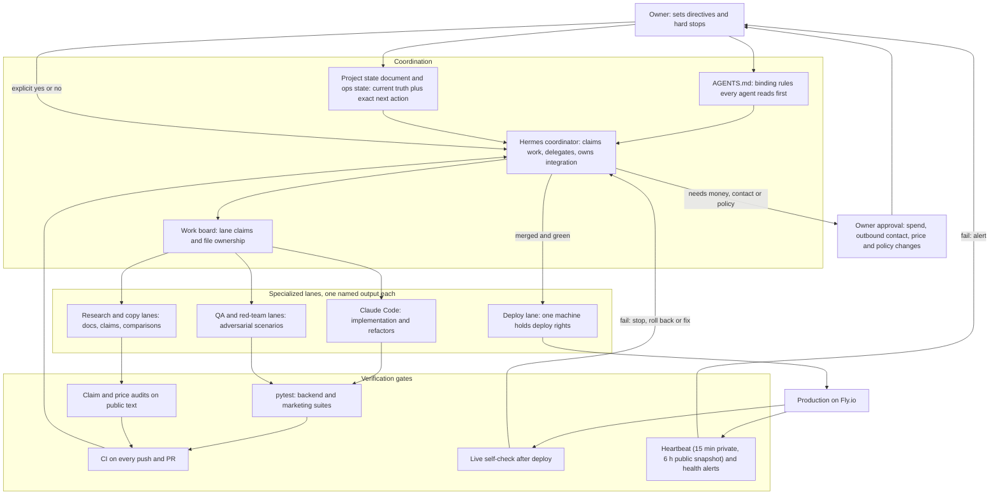

# Agent Engineering Lab

Notes on how I run several AI coding agents on one codebase without losing control of it: who does what, what has to pass before work is accepted, what happens when something fails, and which decisions stay with me.

The code is private. This repo is the write-up, plus sanitized descriptions of the mechanisms in [`docs/`](docs/). The codebase behind it is Call Kettle, an AI phone receptionist for service businesses that runs on Fly.io. A cleaned-up public snapshot is at [samiali38183/call-kettle](https://github.com/samiali38183/call-kettle).

Most of the evidence is private: state documents, logs and the full test suite. [docs/EVIDENCE.md](docs/EVIDENCE.md) says where each claim comes from, and I can walk through the private sources live. The product is deployed on Fly.io and has no customers, no revenue and no measured production traffic.

The agents I used are Hermes Agent (coordination, QA, repo chores, scheduled jobs), Claude Code (implementation and refactors in the repo, against the test suite) and Codex. Codex ran on the same machine, but I have no written lane for it, so I don't describe a role for it. The product's own runtime model is Claude Haiku, using tool use.

## How claims are labeled

Every capability below has one of four labels. My private notes use a finer ladder (proposed, implemented, unit tested, integration tested, deployed, production verified, proven with real customers), and I collapse it here.

| Label | Meaning |
|---|---|
| DEPLOYED | Running in production on Fly.io, or a scheduled job that is running. |
| TESTED | A named automated test, script or recorded run covers it. |
| IMPLEMENTED | The code or rule exists, and I have no stronger evidence than reading it. |
| PLANNED | Written down as a next step and not built. |

Nothing here is a customer, revenue or uptime claim. Production evidence for Call Kettle is test calls between my own numbers, signed-request probes and a live self-check.

## How the workflow fits together

The agents never talk to each other directly. They communicate through files I can read: rules, a state document, a work board and a log. That makes every decision auditable afterwards, and one file can stop the whole loop.

## Delegating work across agents

IMPLEMENTED, used daily. [docs/WORKFLOW.md](docs/WORKFLOW.md) has the details.

- `AGENTS.md` holds the binding rules (brand, pricing source, secrets, outbound limits, deploy windows). It opens with "start here, whatever tool you are". The public snapshot also has a `CLAUDE.md` for Claude Code. I write rules as constraints an agent can check a draft against, not as goals.
- A project state document records what is deployed, what is verified, what is blocked and the exact next action. A new session reads it, then `git log` and `git status`, then re-verifies against reality (test suite, self-check, audit) before continuing. The message "CONTINUE" means exactly that.
- A coordinator hands work to lanes. Each lane (for example a dashboard UI lane, a call-summary lane, a CRM lane or an integrator lane) gets a named output file, and no two writers share a file. The written operating state caps delegates per run, caps retries at two per action, and tells the coordinator to record a blocker and move on instead of looping.
- A `PAUSE` file halts the coordinator. A `LOCK` file that expires after three hours stops two runs working at once.
- I use two machines on one repo with a claim protocol. A work board assigns lanes and file ownership to each machine. A small standard-library helper script (claim, done and check) takes claims by pushing, refuses claims outside your lane, fails on stale claims with no progress note, and never force-pushes. It has its own tests, including a two-clone race.
- One integrator lane merges the lane branches, which end with a "READY" checkpoint commit, into a release branch, runs the gates and deploys. Agents don't merge each other's work.
- The rules name a fallback model order for when the primary model's capacity runs out, and they require review of anything a weaker local model produces. That's written policy, and I haven't exercised it.

## Validation and testing

I accept agent output because it passes gates, not because the agent sounds confident.

| Gate | What it checks | Status |
|---|---|---|
| `pytest`, backend | Behavior, failure injection, tenant isolation, truth invariants, regression pins | TESTED |
| `pytest`, marketing | Document builders, claim and price tooling, the work-board helper | TESTED |
| `audit.py`, `pricing_audit.py` | Public documents against a facts file and a claims registry; any price-looking amount that isn't in the single plan source fails | TESTED |
| Rule-as-test | A retired brand name must not appear in customer-visible output, and a test fails if it does | TESTED |
| CI | Builds generated files, then runs the audits and both suites on every push and PR | IMPLEMENTED (private repo) |
| Live self-check | A script that checks the running service after each deploy: signature enforcement, private pages, the new-client pipeline | DEPLOYED |

Where each test count comes from:

- The private backend suite had 5,342 tests collected by `pytest --collect-only` on 2026-11-05, and I re-ran the same command on 2026-11-13 and got 5,342 again. This is collection only. I didn't run all of them for this write-up.
- The last recorded result for the private full suite is 7,516 passed, 5 skipped and 1 xfailed, from a lane checkpoint commit on 2026-10-29. An earlier recorded run was 4,134 passed (2026-10-15).
- The public Call Kettle snapshot collects 1,626 tests. A full run on 2026-11-13 gave 1,524 passed, 1 skipped and 101 xfailed. The xfails are tests that need files the sanitized export left out.

I record failures as well as passes. The notes list known environment failures (Windows temp-database teardown errors, tests that depend on files outside the tree) as pre-existing on a clean checkout, so a red run isn't blamed on the wrong change. I root-caused one flaky token-budget test instead of re-running it until it passed. The prompt embeds the wall-clock date and the open/closed state, so its size shifted by a few tokens. The fix pins the clock.

For a reported bug, the order is a failing test and then the fix, and the test stays as a regression pin. One resilience pass added 75 failure-scenario tests, and 18 of them failed against the code before the fixes. A red-team pass ran 40 caller scenarios and recorded each finding with a test that fails before the fix and passes after.

The production end-to-end run on 2026-10-22 used a throwaway tenant, real calls between my own numbers and live payment events. It recorded PASS, FAIL-then-FIXED and NOT DONE rows side by side, including the step it couldn't finish without typing a card number. Three bugs found there each got regression tests.

## Failure handling

Workflow level (IMPLEMENTED):

- A retry cap of two per action per run, then a recorded blocker.
- Stale-claim detection on the work board, and lock expiry on the coordinator.
- Status comes from evidence. A controller log checks each lane's claimed status against commit age and checkpoint commits, and marks a lane "unverified" when it finds neither.
- Check for orphaned test processes before and after every full suite run, because leftovers caused lock errors that looked like regressions.
- Deploys follow a passing suite, are scheduled outside customers' business hours by rule, and the previous release image is recorded as the rollback target.

Product level (TESTED, and the public snapshot has the tests): the caller always gets valid voice markup and a next step. A model timeout, a 429 or 500, malformed model output, a tool loop that never ends, a locked or full SQLite database, a failed booking write, and Twilio retrying the same request each have a defined behavior (hand off to the owner, take a message, replay the cached answer) and a test. A locked database used to hold a turn long enough to miss the telephony webhook deadline. Live-path writes now wait briefly and trip a short circuit breaker, so a lock costs a log row and not the call. See [docs/GUARDRAILS.md](docs/GUARDRAILS.md).

## What stays with me

IMPLEMENTED as rules in `AGENTS.md`, and some are enforced in code. Agents get wide freedom over code, tests, docs and research. These decisions stay with me:

| Decision | How it's held |
|---|---|
| Any new spend (services, numbers, domains, ads) | Hard stop. The agent writes the request (item, price, reason, cheapest alternative) to an approvals file and keeps working on other things. |
| Contacting prospects (calls, email, text) | A person places the calls. AI-voiced or automated outbound calls are prohibited. Opt-outs are permanent. |
| Price and plan changes | One plan file is the only source, and the audit fails on any price-looking amount that isn't in it. |
| Public claims | A claims registry gives each claim a state, and claims that aren't proven yet may not appear publicly. |
| Deploys | One deploy-capable machine, outside business hours. |
| Secrets | Never pasted into prompts or chats. Production uses platform secrets. |
| Payment test mode to live | An explicit action by me. |

Some limits are also enforced in code. Texting and call recording stay off unless an environment flag is set, and the rules say the flag is set only after a registration or test passes.

## The runtime agent

TESTED, and the public snapshot has the code. The model proposes and the code decides.

1. One session per call holds the history. The system prompt is built from the tenant's config facts and whether the line is in hours right now.
2. Each utterance is cleaned and sent to Claude Haiku with a typed tool list built per tenant. A tool the tenant has disabled isn't offered, and it is checked again if called.
3. While the response ends in `tool_use`, code runs the tool, adds the `tool_result` and calls the model again. Iterations per turn are capped at 4, reply tokens are capped, and the API client has a short timeout and one retry.
4. Code checks tool inputs again: text cleaning, slot parsing, hours and lead-time rules, one booking per slot (a `BEGIN IMMEDIATE` transaction plus a unique constraint), and ownership checks so a caller can only change bookings made on their own call or caller ID.
5. Before any text is spoken, guards compare it with what happened. The agent can't say it booked, cancelled or rescheduled unless the matching tool succeeded. The claim guard has three patterns (booked, cancelled, moved) and doesn't cover transfers. Spoken dates are corrected against the real calendar.
6. Emergency phrases (gas, carbon monoxide, fire) skip the model and go to a fixed 911 message plus an owner alert.

The tenant's `Policy` block is a strict Pydantic model (`extra: forbid`). Hours, timezone, webhook URLs and the AI disclosure are validated when the config loads. Unknown top-level keys in the tenant file aren't rejected yet, and that gap is listed in the call-kettle README. [docs/GUARDRAILS.md](docs/GUARDRAILS.md) goes through each layer and the threat it addresses.

## Deployment and load testing

- DEPLOYED: FastAPI on Fly.io, one small VM, SQLite in WAL mode on a persistent volume, one process. A daily database backup with a restore test, plus volume snapshots. Tenant configs can be pushed to the volume through a validated admin endpoint without a deploy.
- DEPLOYED: an external heartbeat, which is a GitHub Actions job that checks the API health route and the public site. It runs every 15 minutes in the private repo and every 6 hours in the public snapshot's workflow. As of late October there are also scheduled agent jobs for health alerts and a weekday brief.
- TESTED: a concurrency harness drives the real FastAPI app in-process with a stubbed 900 ms model call at 8, 16, 32 and 64 simultaneous callers.

The load test found a race. The per-tenant concurrent-call ceiling was a count-then-act check, and the call row is written several steps after the count. A burst of simultaneous webhooks all read the same count and all passed. Before the fix, with a ceiling of 24 and 64 simultaneous callers, 42 were admitted. The fix holds a call in an in-process set under a lock between the check and its row. After it, admission equals the ceiling exactly at 16, 32 and 64 callers, and a regression test pins it. An earlier run with 42 calls admitted at once had also lost two transcript writes.

The numbers have limits. The harness ran on my Windows dev box, not the Fly VM, with a stubbed model. It exercises admission, the thread pool and SQLite, but not real Anthropic latency or Twilio and Deepgram limits. There was one run per cell and no repetition statistics, and one unexplained 5 s outlier at 16 callers didn't reproduce. The fix is process-local, which is correct for one machine. Going multi-machine means moving the claim into SQLite or a shared store. The race fix and the harness are in the private codebase, not in the public snapshot.

## Security practices

Call Kettle is on the public internet and takes speech from anyone with a phone, so caller input is untrusted at every layer. [docs/GUARDRAILS.md](docs/GUARDRAILS.md) has the full list.

- Secrets live in platform secrets and the environment file is git-ignored. A test fails if a secret value shows up in a tracked file, and the master key is tested never to appear in a page, link or log.
- Telephony webhooks fail closed without a valid request signature. Admin and report routes refuse anonymous requests, and a test enumerates every route so a new unguarded one fails the suite.
- The tenant comes from the signed URL, not from the model. Tests check that one tenant can't read or book into another's data.
- Booking changes are authorized in server code, so an injected model still can't touch another caller's booking. An adversarial persona run against the real model on 2026-09-30 passed 17 of 18 cases, and I fixed the one failure.
- A cost-based monthly ceiling per tenant switches a call to message-capture mode (no model) once it's reached. Degraded calls and concurrent calls are capped. A worst-case-loss model is pinned in tests and labeled MODELED, never measured.
- Card and SSN-shaped numbers are scrubbed from stored transcripts. Logs redact keys, emails and all but the last four phone digits. Transcripts are deleted automatically after 90 days.
- Owner-portal changes are written to an audit table, and every work-board state change is a git commit.
- The outbound compliance policy says it isn't legal advice and that no lawyer has reviewed it. It requires human-placed calls only, a call-hours window, truthful identity, permanent suppression, a working opt-out, and a separate sender for sales and transactional email.
- Cloud coding sessions are specified to get one repo, no production secrets, a branch and review before merge. That is a written guide, and I'm not claiming it as a running pipeline.

## Call Kettle

Call Kettle answers calls for home-service businesses, books or moves appointments inside the owner's hours, takes a message or transfers to a person, and gives the owner a portal with bookings and transcripts. This workflow grew up on that codebase, which had about 870 commits in its private history as of early November 2026 (868 on 2026-11-05), written by hand and with the agents above. It is deployed. It hasn't been proven with customers, and I make no customer or revenue claims.

## What is public and what is private

| Public | Private |
|---|---|
| This write-up and `docs/` (generalized mechanisms) | Directive files, state documents, controller logs, work-board contents |
| [call-kettle](https://github.com/samiali38183/call-kettle): sanitized app code, tools, the strict `Policy` schema, 1,626 collected tests, a price scanner | Production config, tenant data, pricing and margin models, prospect research, sales material, credentials |
| The load-test numbers quoted above | The concurrency harness and the race fix |

I don't publish business figures, prospect or customer information, or sales material here. Private files are described instead of named, so a claim stays traceable by description.

## Limitations

- The strongest evidence (state documents, logs, the full suite) is private. I can walk through it live, but this repo can't prove it.
- Test counts are collection counts or recorded results. The public snapshot was run in full on 2026-11-13, and the private suite wasn't.
- The load test was local with a stubbed model. Behavior on the Fly VM with the real model and carrier hasn't been measured under load.
- There is no customer traffic, so real-call latency, cost per call and error rates are unmeasured.
- The security review is a self-review, not an independent audit or penetration test. The adversarial run against the live model was a spot check of 16 to 18 cases and doesn't give a rate.
- Admission control is process-local, so it only works on one machine.
- Streaming speech-to-text exists but isn't enabled in production.
- A lawyer hasn't reviewed the outbound policy.
- The workflow has overhead. The state documents and logs grow large, and keeping them current is work in itself.

## Roadmap

From open items in my own notes:

- PLANNED: move concurrent-call admission out of process before running more than one machine.
- PLANNED: a real-call pilot that measures several parallel speech-to-text streams before streaming is switched on.
- PLANNED: re-run the adversarial persona suite against the live model on current code each release.

Proposed for this repo:

- PLANNED: publish a sanitized version of the concurrency harness with the numbers it produces.
- PLANNED: a short worked example of one lane from directive to merge, with the real artifacts redacted.

## Contents

- [docs/WORKFLOW.md](docs/WORKFLOW.md): how work is delegated, claimed, integrated and stopped.
- [docs/GUARDRAILS.md](docs/GUARDRAILS.md): the layers between a model suggestion and a consequence, and the threat each addresses.
- [docs/EVIDENCE.md](docs/EVIDENCE.md): each claim above mapped to its source and status.

Portfolio write-up: https://samiali38183.github.io/projects/agent-lab.html
